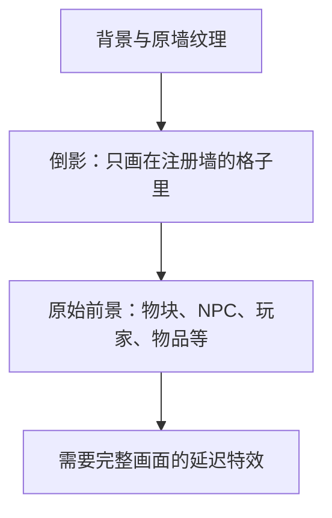
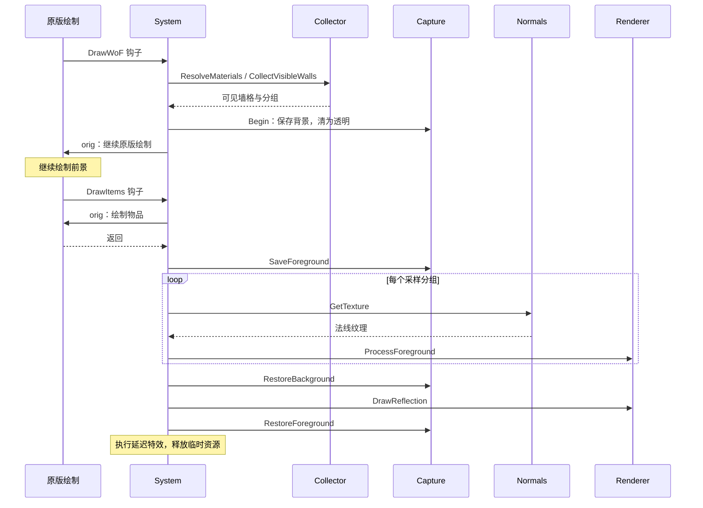

# 镜墙反射

系统把前景保存为纹理，经过投影、法线扰动和模糊处理，再裁剪绘制到注册的背景墙格子里。原墙照常绘制，玩家和物块仍能挡住倒影。

反射只使用捕获到的屏幕图像，不会从镜子位置重新绘制世界。镜面角度只改变倒影，墙格保持原位。当前支持完整的 16×16 Wall 区域，不提供 Tile 镜面或自定义遮罩。

## 阅读路线

- 熟悉 tModLoader：看[注册墙](#register)和[绘制钩子](#hooks)。
- 初次阅读：按画面分层、执行顺序、文件职责往下读。
- 修改代码：从[文件表](#files)定位。

## 画面与执行顺序

RenderTarget2D 是供 GPU 绘制的临时画布。保存背景后，前景在透明底上继续绘制；合成时，透明区域露出后面的墙和倒影。箭头表示接着画在上面；地图单独保存，恢复时保持原有遮挡顺序。



[System](MirrorReflectionSystem.cs) 决定调用顺序：

1. 解析定义，收集可见墙格并分组；没有反光墙就不捕获。
2. 保存背景，清为透明，让原版继续绘制前景。
3. 保存前景，排除单独保存的地图层。
4. 每组取得法线纹理，执行投影、扰动及可选的横纵高斯模糊。
5. 恢复背景，绘制倒影，再恢复原前景与地图。
6. 执行延迟特效，归还临时纹理，恢复 SpriteBatch 状态。



<a id="hooks"></a>

### 绘制钩子

System 在客户端 `Load()` 注册五个 `On_Main` 钩子，`Unload()` 对应注销。`FinishCapture()` 集中写明倒影处理和最终绘制顺序。

| 原版方法 | System 方法 | 用途 |
| --- | --- | --- |
| `DoDraw` | `DrawFrame` | 帧末检查未完成捕获并清理 |
| `DoDraw_WallsTilesNPCs` | `DrawWorld` | 标记正常世界绘制 |
| `DrawWoF` | `BeginForeground` | orig 前保存已画好的背景与墙 |
| `DrawItems` | `EndForeground` | orig 后保存前景并合成 |
| `DrawMap` | `DrawMap` | orig 前后保存地图分层 |

没有血肉墙时也会调用 `DrawWoF`；这里利用它紧接墙面绘制的位置。升级 tModLoader 时需核对原版顺序。Capture 不注册钩子，也不回调 System。

<a id="files"></a>

## 各文件负责什么

| 文件 | 职责与修改内容 |
| --- | --- |
| [System](MirrorReflectionSystem.cs) | 原版钩子、调用顺序、失败恢复 |
| [Definition](Core/MirrorReflectionDefinition.cs) | 反射设置；完整范围见 XML 注释 |
| [Collector](Core/MirrorWallReflectionCollector.cs) | 注册、限制参数范围、计算颜色、收集墙格和分组 |
| [Capture](Core/MirrorScreenCapture.cs) | 保存和恢复背景、前景、地图 |
| [Normals](Core/MirrorNormalMapProvider.cs) | 生成、缓存和释放法线纹理 |
| [Renderer](Core/MirrorReflectionRenderer.cs) | 处理倒影、按墙格裁剪绘制 |
| [Shader](Core/MirrorReflectionShader.fx) | GPU 采样；投影、边界与高斯权重计算在 Renderer 内 |
| [ScreenCaptureRenderHooks](Core/MirrorScreenCaptureRenderHooks.cs) | 捕获期间的混合状态与 VFX 绘制钩子，由 System 控制执行时机 |
| [VanillaProfiles](VanillaMirrorWallProfiles.cs) / [Config](MirrorReflectionConfig.cs) | 原版材质列表 / 全局开关与画质 |

两面墙透明度不同、其他采样设置相同时，可以共用一张倒影。Collector 先把 `Opacity`、`Strength` 换算为每墙颜色，再将分组副本的两值统一为 1；原定义不变。

分组不按墙面连通范围计算。投影基准是本地玩家脚底加 `gfxOffY`，墙面大小不会改变它。每组处理整张前景，因此不同采样定义越多，全屏处理和纹理开销越大。

<a id="register"></a>

## 注册墙与调整效果

将下面的方法放入所属模块现有 `ModSystem`，覆盖原版玻璃墙设置：

```csharp
using Everglow.Commons.Mechanics.MirrorReflection;
using Everglow.Commons.Mechanics.MirrorReflection.Core;
using Terraria.ID;
using Terraria.ModLoader;

public override void PostSetupContent()
{
	ModContent.GetInstance<MirrorReflectionSystem>().RegisterWall(
		WallID.Glass,
		new MirrorReflectionDefinition(0.35f, 1) { Blur = 0 });
}
```

自定义墙改用 `ModContent.WallType<你的墙类型>()`；同类型后注册覆盖先注册。墙的 `PreDraw()` 无需调用倒影绘制，示例见 [YggdrasilWorldSystem](../../../Modules/Yggdrasil/YggdrasilWorldSystem.cs)。

动态重载接受 `Func<MirrorReflectionDefinition>`。每次解析会对所有注册类型各调用一次，不逐格调用，参考 [AdvancedMirrorWallProfiles](../../../Modules/Example/AdvancedMirror/AdvancedMirrorWallProfiles.cs)。

| 参数 | 含义 |
| --- | --- |
| `Opacity` / `Strength` | 覆盖率 / RGB 亮度；Strength 为 0 仍有黑色覆盖，关闭倒影用 Opacity 为 0 |
| `Blur` / `Sigma` | 模糊采样间距 / 权重分布；Blur 为 0 跳过模糊 |
| `NormalPattern` / `NormalPeriod` / `NormalStrength` | 法线图案 / 世界像素周期 / 位移系数 |
| `Offset` / `ReflectionScale` / `FlipHorizontally` | 世界像素偏移 / 缩放 / 左右翻转，默认不翻转 |
| `Pitch` / `Yaw` / `Roll` / `Distance` | 投影角度 / 虚拟透视距离 |

全局画质只选择每方向 3、5、9 点模糊采样，保持相同最远采样范围。各墙自行定义材质。输入仍须是有限浮点数和有效枚举。

[Advanced 面板](../../../Modules/Example/AdvancedMirror/AdvancedMirrorConfigUI.cs) 只影响演示墙。[演示墙 PreDraw](../../../Modules/Example/AdvancedMirror/AdvancedMirrorWall.cs) 用 TileBatch 和角点光照绘制底色；Surface RGB 调的是这层表面，当前倒影没有独立 RGB 调色。
